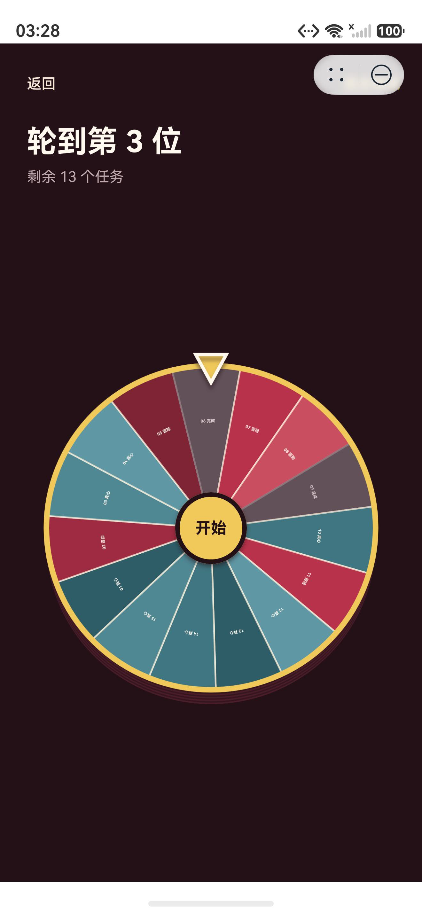
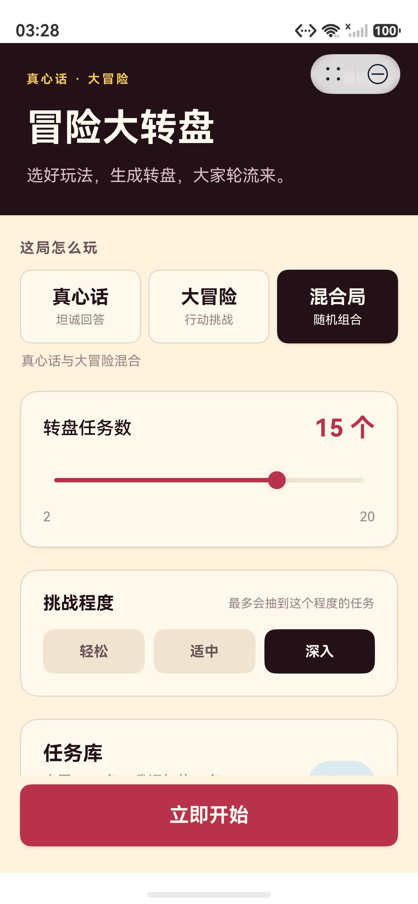
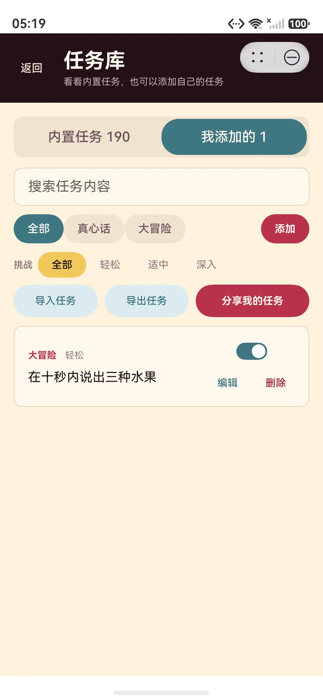
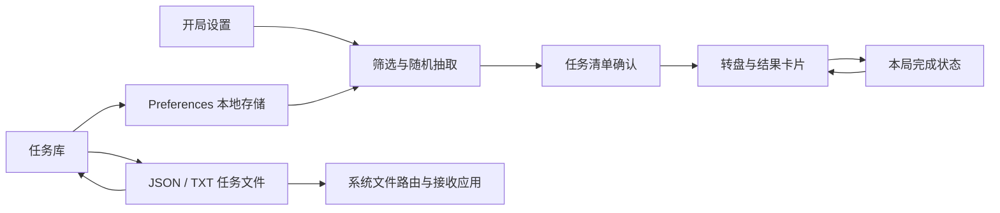

# 冒险大转盘：朋友聚会的真心话大冒险元服务

用 ArkTS 和 ArkUI 构建一款纯本地鸿蒙元服务：确认本局任务，轮流转动转盘，把自定义玩法保存下来，再通过文件带到另一台设备。



| 项目 | 内容 |
| --- | --- |
| 适合谁 | 了解基础 ArkTS / ArkUI，希望实践交互动画、本地数据和元服务文件能力的开发者 |
| 难度与耗时 | 入门到进阶；环境就绪后约 15 分钟体验，约 1–2 小时完成代码学习与功能验收；耗时为估计 |
| 你将学到 | Canvas 转盘与透视效果、随机抽取与同局去重、Preferences 本地持久化、结构化任务文件迁移 |
| 你将完成 | 一款支持开局确认、轮流抽取、任务管理及文件导入导出的手机元服务 |
| 验证依据 | 2026-10-01 逻辑测试 17/17 通过；2026-09-30 无签名 Release HAP 构建成功；已有 API 24 模拟器运行记录和截图来自 2026-08-26 |

阅读路线：先运行 → [快速体验](#3-快速体验) · 学习实现 → [完整实践](#4-完整实践) · 检查结果 → [验收与排障](#5-验收与排障)。

源码仓库：[HarmonyOS-APP-adventure-wheel](https://gitcode.com/harmony-practice-center/HarmonyOS-APP-adventure-wheel)。案例发布包：[素材预览](./docs/发布物预览.html) · [8 步实践教程](./cases/practice.html) · [平台导入说明](./docs/案例导入说明.md)。平台实际导入和当前版本设备验收仍待完成。

## 1. 案例概览

朋友线下聚会时，把手机放在大家面前，选择玩法和挑战程度，生成本局任务。参与者轮流点击转盘中心，指针停下后查看完整任务，再交给下一位。任务库既能查看内置内容，也能保存自己设计的玩法。

这个案例可以迁移到随机抽签、活动互动、学习练习等场景，重点是把抽取规则、动画展示和本地数据分开管理。

### 核心功能与体验

1. 选择真心话、大冒险或混合局，设置 2–20 个任务及最高挑战程度。
2. 点击“立即开始”，先查看实际任务清单；可以重新生成，确认后进入转盘。
3. 点击中心“开始”，转盘减速停止，突出命中扇区，再以动画展示居中结果卡片。
4. 点击“交给下一位”，当前任务变为灰色并标记“完成”，不再参加本局抽取；最后一个任务显示“完成本局”。不想做的任务也可以交接跳过。
5. 浏览 190 条内置任务，搜索、筛选；添加、编辑、启停或删除自己的任务，每条最多 30 个字符。
6. 导出自定义任务为 JSON 文件，或点击“分享我的任务”生成 TXT 文件；TXT 内部仍是 JSON 文本。新设备可通过“导入任务”恢复。

| 开局设置 | 本地任务库 |
| --- | --- |
|  |  |

以上为 2026-08-26 模拟器实拍，不代表本次重新完成设备验收。

### 技术方案一览



内置任务随工程打包，自定义任务和设置保存在设备本地。开局时先按玩法、挑战程度筛选，再随机组成本局清单；自定义任务最多占本局任务数的一半。转盘结果从未处理任务中随机选取，动画负责把指针停到对应位置。

| 层级 | 技术 | 作用 |
| --- | --- | --- |
| 页面 | ArkTS / ArkUI，Stage 模型 | 设置、任务库、转盘和结果交接 |
| 视觉 | Canvas、透视旋转、缩放与透明度动画 | 2.5D 转盘、命中反馈和结果入场 |
| 数据 | Preferences、JSON | 设置与自定义任务持久化，文件迁移 |
| 文件 | DocumentViewPicker、文件 URI、隐式 Want | 用户选择导入导出位置，并把 TXT 交给接收应用 |
| 工具 | DevEco Studio、Hvigor、hdc、Node.js | 编译、设备运行和纯逻辑测试 |

分享入口采用系统文件路由。是否显示应用选择、有哪些接收应用、接收后执行什么动作，由设备和目标应用决定；打开目标应用不等于文件已成功发送。历史模拟器验证只确认了路由启动，跨应用接收和再次导入仍需在实际设备验收。

## 2. 开始之前

### 环境与资源

| 项目 | 要求 | 检查方式 |
| --- | --- | --- |
| 基础知识 | ArkTS 基础、ArkUI 页面与状态管理 | 能定位 `entry/src/main/ets/pages/` 中的页面 |
| 开发工具 | DevEco Studio 及其配套 HarmonyOS SDK、Node.js、Java、Hvigor | IDE 能识别工程并完成同步 |
| 当前 SDK 配置 | 编译 SDK 随 DevEco Studio；目标 `6.1.0(23)`，最低兼容 `6.0.0(20)` | 查看根目录 `build-profile.json5` |
| 设备 | 手机模拟器或手机；已有运行验证为 API 24，API 20 实跑待补 | 设备管理器启动后，`hdc list targets` 有设备 |
| 账号与签名 | 纯逻辑测试和无签名打包不需要云资源；设备安装按环境准备自己的调试签名 | IDE Signing Configs 使用自己的配置 |
| 网络与费用 | 玩法和存储无需后端；工具、SDK 下载及首次工程同步可能需要联网 | 不需要创建云函数、数据库或付费服务器 |

2026-09-30 使用 DevEco Studio `26.0.0.821` 配套 API 26 SDK 完成无签名 Release 构建。工程不再固定编译 SDK，仍保留目标 API 23、最低兼容 API 20。编译版本与最低可安装版本是不同配置；最低版本运行验证仍需补齐。

### 配置与数据

公开工程不包含签名口令、证书私钥或本机签名引用，可以生成无签名 HAP。需要设备安装时，在 DevEco Studio 中配置自己的调试签名。修改后不要把签名材料或口令提交到仓库。

签名、本地配置、开发工具元数据和构建产物已由忽略规则排除。提交前还需检查暂存区，当前核对结果见[发布前核对](./docs/发布前核对.md)。

## 3. 快速体验

这条路线面向“先把现成工程跑起来”的读者。预计 15 分钟不包含工具下载和签名准备时间。

### 1）打开工程

在用于存放工程的目录中，使用 Windows PowerShell 获取仓库默认分支：

```powershell
git clone https://gitcode.com/harmony-practice-center/HarmonyOS-APP-adventure-wheel.git
Set-Location .\HarmonyOS-APP-adventure-wheel
```

完成标志：当前目录包含 `AppScope/`、`entry/` 和 `cases/`。如果你已经获取源码，直接使用现有工程目录。

在 DevEco Studio 中打开包含 `AppScope/`、`entry/`、`build-profile.json5` 和 `oh-package.json5` 的工程根目录，等待同步结束。

完成标志：IDE 识别 `entry` 模块，能打开 `SetupPage.ets`，同步面板没有阻断错误。

### 2）检查配置并构建

核对第 2 章的 SDK 配置，按目标选择无签名打包或自己的调试签名。通过 IDE 的构建菜单生成 HAP。

完成标志：构建输出出现 `BUILD SUCCESSFUL`，`entry/build/default/outputs/default/` 下生成新的 HAP。仅存在旧包不能证明本次构建成功。

### 3）启动并完成两轮游戏

启动手机模拟器，选择 `entry` 后点击 IDE 运行按钮。首页选择“混合局”、6 个任务和“适中”，点击“立即开始”，查看清单后点击“确认开局”。

点击转盘中心“开始”，等结果出现后点击“交给下一位”，再转一次。

完成标志：首页显示“冒险大转盘”；两轮任务 ID 不同，第一轮扇区变灰并标记“完成”，剩余数量减少。

### 4）保存一条自己的任务

返回首页，在任务库进入“我添加的”，添加“在十秒内说出三种水果”，选择“大冒险 / 轻松”并保存。退出并重新启动元服务，再查看任务库。

完成标志：任务仍然存在，可以编辑或停用；超过 30 字的内容不能保存。

## 4. 完整实践

### 步骤 1：理解元服务入口与三页分工

目标：定位从启动到开局的完整路径。

操作：阅读 [EntryAbility](./entry/src/main/ets/entryability/EntryAbility.ets)、[页面注册](./entry/src/main/resources/base/profile/main_pages.json) 和 [SetupPage](./entry/src/main/ets/pages/SetupPage.ets)。追踪设置页如何加载本地配置、生成任务预览，再把已确认清单传给转盘页。

完成标志：能说明“立即开始”先打开清单确认层，确认后才进入转盘；任务库是独立管理页。

### 步骤 2：理解随机抽取与同局去重

目标：区分开局抽样与转盘命中两套规则。

操作：阅读 [TaskEngine](./entry/src/main/ets/engine/TaskEngine.ets) 的模式、挑战程度筛选及洗牌逻辑，再阅读 [WheelRoundState](./entry/src/main/ets/engine/WheelRoundState.ets) 和 [WheelPage](./entry/src/main/ets/pages/WheelPage.ets) 的完成状态更新。

完成标志：本局自定义任务不超过 `floor(任务数 × 0.5)`；交接后当前任务退出候选池。完成状态只属于当前一局，重新开局仍可能抽到之前玩过的任务。

### 步骤 3：连接转盘、命中与结果动画

目标：理解视觉效果如何与真实抽取结果保持一致。

操作：阅读 [WheelCanvas](./entry/src/main/ets/components/WheelCanvas.ets) 的目标索引、停止角度、减速动画和完成扇区绘制；阅读 `WheelPage` 的命中强调及结果卡片入场。观察转动期间中心按钮的禁用状态。

完成标志：指针命中的扇区与结果任务一致；再次点击不会在旋转中启动第二次抽取；结果卡片居中出现。这是 Canvas 配合透视变换的 2.5D 效果。

### 步骤 4：维护本地任务并迁移文件

目标：把自定义任务保存下来，并理解跨设备迁移格式。

操作：阅读 [LocalTaskStore](./entry/src/main/ets/store/LocalTaskStore.ets)、[TaskTextRules](./entry/src/main/ets/service/TaskTextRules.ets) 和 [TaskTransferService](./entry/src/main/ets/service/TaskTransferService.ets)。新增一条测试任务，导出后再次导入；重复导入时查看统计。再打开 TXT 分享入口，核对实际接收应用。

完成标志：重新启动后任务保留；重复导入不增加相同任务；JSON 与 TXT 都使用相同的版本化 JSON 结构。字段、上限及示例见[任务文件格式](./docs/任务文件格式.md)。

### 步骤 5：运行规则测试并完成设备验收

目标：验证数据规则、业务闭环和真实设备能力。

操作：在工程根目录运行下述 Windows PowerShell 示例；`$devEcoRoot` 从 IDE 安装位置取得，不是工程目录。

```powershell
$devEcoRoot = Read-Host '请输入 DevEco Studio 安装目录'
$env:DEVECO_SDK_HOME = Join-Path $devEcoRoot 'sdk'
& (Join-Path $devEcoRoot 'tools/node/node.exe') '.\tools\run-logic-tests.mjs'
```

完成标志：输出 `ALL 17 LOGIC TESTS PASSED`。这是纯逻辑测试，不代替 ArkTS 构建、Preferences 实际读写、动画和文件接收验收。继续按下一章在设备上逐项检查。

## 5. 验收与排障

### 业务验收

| 操作 | 预期结果 |
| --- | --- |
| 切换三种玩法，调整任务数量和挑战程度 | 生成清单数量正确，类型及程度符合选择，确认前不进入转盘 |
| 连续抽取并交接 | 已处理扇区变灰、显示“完成”，同一局不再抽到该任务；最后一个任务可结束本局 |
| 查看内置任务，搜索和筛选 | 可以浏览 190 条内容；内置任务没有编辑和删除入口 |
| 新增、编辑、启停、删除自定义任务 | 变更保存在本地；停用任务不参与抽取；空内容和超长内容被拒绝 |
| 导出，再重复导入相同文件 | 显示可导入、重复和无效条数，确认后合并，不覆盖已有任务 |
| 导入非法格式、超长任务及超过 1 MB 的文件 | 给出错误或无效统计，不写入不合格任务 |
| 分享 TXT，并在接收设备导入 | 接收端取得文件；恢复正文、类型、挑战程度和启用状态，需实际设备验证 |

### 验收依据与当前状态

| 项目 | 状态与依据 |
| --- | --- |
| 本次文档与规则核对 | 2026-10-01；以当前工程及待提交内容为依据 |
| 本次纯逻辑测试 | 17/17 通过，覆盖随机抽取、去重、30 字限制、导入校验及传输字段往返 |
| 最近 Release 构建 | 2026-09-30 通过：使用配套 API 26 SDK 生成无签名 HAP；目标 API 23、最低兼容 API 20；本次未重新打包 |
| 历史设备验证 | 2026-08-26 API 24 手机模拟器记录：开局确认、任务库、连续抽取、结果动画、完成标记及文件路由 |
| 本次设备验收 | 未重跑；检查时 `hdc list targets` 无已连接设备 |
| 待补验收 | 当前新包的完整设备运行、最低 API 20、真机表现、TXT 实际接收与再次导入 |
| 已知迁移限制 | 单个任务文件最多导入 1000 条，但添加与导出没有总量限制；超过 1000 条的完整备份会被拒绝导入，尚待修复 |

本次检查详情及发布缺口见[发布前核对](./docs/发布前核对.md)。旧构建产物及历史截图不作为本次编译或最低版本兼容的通过证据。

### 高频问题

| 现象 | 原因与处理 | 恢复标志 |
| --- | --- | --- |
| 构建报 `00303313` | 检查是否手动固定了与当前工具不匹配的 `compileSdkVersion`；使用 IDE 配套 SDK 或匹配工具。保留目标 API 23、最低兼容 API 20 | 新构建成功，重新完成设备验收 |
| 构建提示没有 `signingConfig` | 公开工程默认无签名，是预期状态；仅打包无需补签名，安装运行时配置自己的调试签名 | 无签名打包成功，或自己的签名包可安装 |
| 提示找不到 Java | 构建进程没有使用 IDE 配套 Java；核对 `JAVA_HOME` 和当前终端 PATH | 构建器能启动 Java 并继续编译 |
| 无法选择或保存文件 | 设备文件服务不可用、用户取消，或目标位置无权限 | 在支持的设备上重新选择文件或保存位置 |
| TXT 不能导入 | TXT 正文必须是约定的 JSON；普通任务列表文本不符合格式 | 按[任务文件格式](./docs/任务文件格式.md)导入，出现统计确认框 |
| 分享打开了一个应用而没有选择面板 | 系统只找到一个匹配接收应用；目标列表取决于已安装应用 | 接收应用实际取得 TXT 文件；仅启动不能视为发送成功 |
| 提示没有可接收任务文件的应用 | 设备没有匹配的 `text/plain` 接收入口 | 使用“导出任务”保存文件，再通过可用渠道传递 |
| 自定义任务没出现在本局 | 可能停用、类型或挑战程度不匹配，或随机抽取达到 50% 上限 | 调整条件，重新生成并检查确认清单 |

## 6. 安全与清理

自定义任务保存在设备本地，没有账号或自动云同步。更换设备或清除元服务数据前，先导出任务并在目标设备确认导入成功。卸载、清除应用数据可能导致本地记录丢失；外部导出的文件需要自行保管。

任务文件是明文，可能包含用户写下的私人内容。分享会包含全部自定义任务，包括停用项，不包含内置任务、本地 ID 和时间戳。发送前检查任务内容和接收对象。

内容规则只校验长度、字段和重复项，不自动判断每条自定义任务是否适宜。设计任务时遵守法律法规，避免危险行为、隐私披露及打扰未参与活动的人；参与者可以自愿跳过。

本案例没有需要释放的云资源。体验结束后，可在任务库删除自己创建的测试任务；删除外部备份前先确认没有迁移需要。公开源码前按[发布前核对](./docs/发布前核对.md)处理签名配置及本地材料。

## 7. 项目导览与进阶

### 关键目录

```text
工程根目录/
├── README.md                         # 案例入口
├── LICENSE                           # Apache-2.0 许可证
├── NOTICE.md                         # 源码与素材许可说明
├── AppScope/                         # 元服务名称、图标和包类型
├── entry/src/main/
│   ├── module.json5                  # 免安装属性、入口和设备范围
│   ├── ets/
│   │   ├── pages/                    # 设置、任务库、转盘
│   │   ├── components/               # Canvas 转盘等组件
│   │   ├── engine/                   # 开局抽样与本局完成规则
│   │   ├── store/                    # 本地任务及设置持久化
│   │   ├── service/                  # 字数、任务文件校验及读写
│   │   ├── model/                    # 任务与游戏配置
│   │   └── data/task-source.ets      # 内置任务内容
│   └── resources/                    # 图标、字符串和页面注册
├── tools/
│   ├── run-logic-tests.mjs            # 17 项纯逻辑测试
│   └── check-public-source.mjs        # 暂存区敏感信息与引用检查
├── cases/                            # case.json、实践教程及五类发布图片
└── docs/                             # 文件格式、发布核对和效果图
```

### 深入阅读与扩展

- [设计说明](./docs/设计说明.md)：理解本地任务库、开局确认、随机规则、转盘视觉和兼容策略。
- [发布前核对](./docs/发布前核对.md)：查看当前测试、构建与暂存区检查依据，并了解待补设备验收。
- [任务文件格式](./docs/任务文件格式.md)：复用版本化 JSON、字段校验和只合并不覆盖的迁移思路。
- [案例导入说明](./docs/案例导入说明.md)：发布包文件、生成器版本及公开仓库待补条件。

完成实践后，可以进一步为大字体、小屏和折叠屏增加专项适配，补齐 API 20 真机或模拟器回归，完善不同应用的文件接收验证。目前工程只声明手机，扩展设备范围前应先验证对应布局和能力。

## 8. 参考与维护

### 官方资料与反馈

- [DevEco Studio](https://developer.huawei.com/consumer/cn/deveco-studio/)：开发工具入口。
- [DocumentViewPicker API](https://developer.huawei.com/consumer/cn/doc/harmonyos-references/js-apis-file-picker)：用户选择文件和保存位置。
- [Hvigor 配置错误说明](https://developer.huawei.com/consumer/cn/doc/harmonyos-guides/ide-hvigor-errorcode-00303-1#section191211454141814)：构建器给出的官方排障入口。

通过[源码仓库](https://gitcode.com/harmony-practice-center/HarmonyOS-APP-adventure-wheel)的 Issues 入口反馈问题，提供玩法、设备系统、复现步骤和脱敏截图。不要提交签名口令、证书私钥或私人任务文件。

### 维护信息

| 项目 | 内容 |
| --- | --- |
| 案例归属 | 鸿蒙开发实践中心 · 在线开发实践平台 |
| 当前案例文档版本 | 1.0；表示案例文档整理，不对应 Git tag；工程应用版本为 `1.0.0` |
| 代码获取方式 | 从上述 GitCode 仓库默认分支获取最新内容 |
| 最近文档与逻辑验证 | 2026-10-01 |
| 最近已有设备验证记录 | 2026-08-26，API 24 手机模拟器 |
| 兼容配置 | 编译 SDK 随 IDE，本次 API 26；目标 API 23、最低兼容 API 20；最低版本实跑待补 |

案例迭代记录：2026-08-26 的实现记录包含樱桃可乐配色、2.5D 转盘、本地任务库、30 字限制、同局完成标记及 TXT / JSON 文件迁移；2026-09-30 按统一案例模板整理学习入口，并重新核对逻辑测试与当前构建状态；2026-10-01 补齐公开仓库地址、获取与反馈入口，并明示任务迁移数量边界。

### 许可证

本仓库原创源码和文档采用 [Apache License 2.0](./LICENSE)。图标、截图和第三方标识的说明见 [NOTICE](./NOTICE.md)，不自动将代码许可证扩展到第三方素材和商标。
