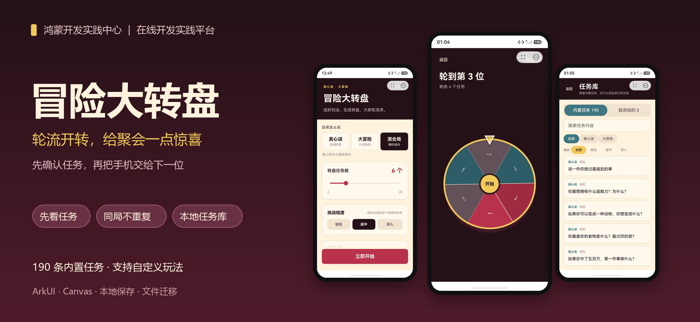
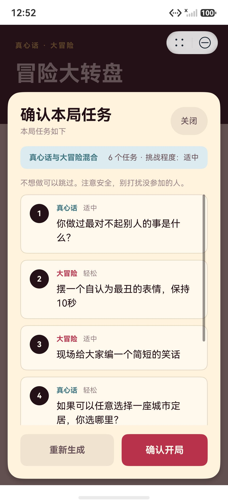
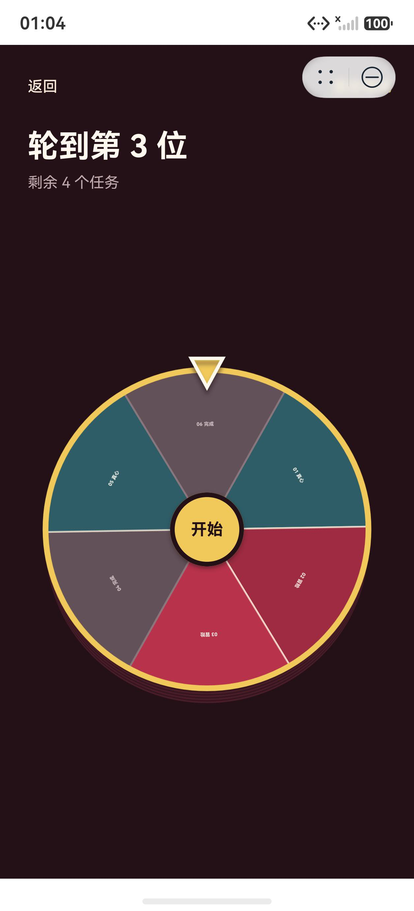
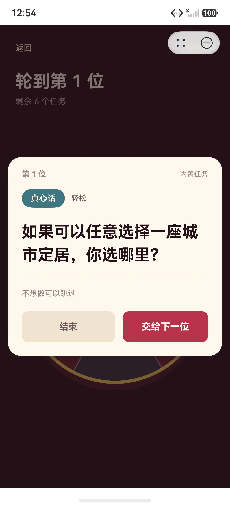
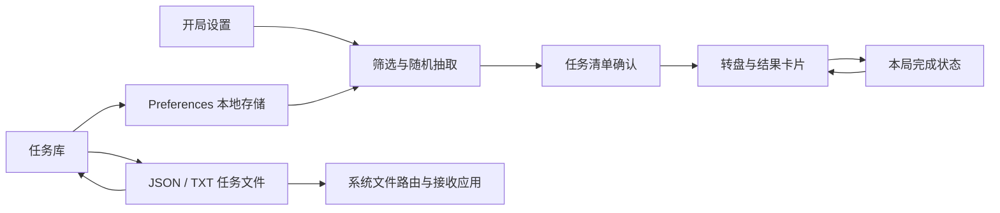

# 冒险大转盘：用 AI 制作朋友聚会的真心话大冒险元服务

用 AI 对话体验一款纯本地鸿蒙元服务，再从空项目构建自己的版本：确认本局任务、轮流转动转盘、保存自定义玩法，通过文件带到另一台设备。



| 项目 | 内容 |
| --- | --- |
| 适合谁 | 能使用 AI 编程工具、愿意核对界面和运行结果的开发者；不要求先会手写 ArkTS |
| 难度与耗时 | 入门到进阶；快速体验约 15–30 分钟，从空项目实践约 2–4 小时，均为估计，不含工具、镜像下载和签名准备 |
| 你将学到 | 分阶段需求与开发、随机抽取与同局去重、转盘动画、本地持久化与文件迁移 |
| 你将完成 | 体验现成元服务，并独立构建“设置 → 清单确认 → 轮流抽取 → 任务管理”的使用闭环 |
| 实践环境 | 云端开发环境或本地码道 IDE；HarmonyOS 工具链、手机设备或模拟器；目标 API 23，最低兼容 API 20 |

阅读路线：先看到结果 → [快速体验](#3-快速体验) · 从头制作 → [完整实践](#4-完整实践) · 遇到问题 → [功能检查与排障](#5-功能检查与排障)。

源码仓库：[HarmonyOS-AtomSer-AdventureWheel](https://gitcode.com/harmony-practice-center/HarmonyOS-AtomSer-AdventureWheel)。

## 1. 案例概览

朋友聚会时，把手机放在大家面前，选好玩法与挑战程度，生成一张大转盘。每人点击一次，按结果完成任务，再交给下一位。这个案例帮助你把随机规则、交互动画和本地数据分开管理，也能迁移到活动抽签、学习练习等场景。

### 核心功能与体验

1. 选择“真心话 / 大冒险 / 混合局”，设置 2–20 个任务和最高挑战程度。
2. 点击“立即开始”，先看本局清单；不满意可“重新生成”，确认后才开局。
3. 点击中心“开始”，转盘减速停下，突出命中扇区，以动画显示居中的完整任务卡片。
4. 点击“交给下一位”，当前任务变灰并标记“完成”，本局不会再抽到；最后一项显示“完成本局”。不想做也可以交接跳过。
5. 在“任务库”查看 190 条内置任务，或添加、编辑、启停、删除自己的任务；自定义正文最多 30 个字。
6. 导出自定义任务为 JSON，或通过“分享我的任务”生成 TXT 交给接收应用；TXT 正文仍是 JSON，新设备可导入恢复。

| 开局前确认 | 转盘与完成标记 | 抽取结果 |
| :---: | :---: | :---: |
|  |  |  |

首页、任务库及完整原图见[截图与教学素材索引](./docs/实践素材说明.md#原始视觉参考)。

### 技术方案一览



内置任务随工程打包，自定义任务与设置保存在本机。开局先筛选再随机组成清单，自定义任务最多占本局数量的一半。每次转动只从尚未处理的任务中选取，动画把指针停到对应扇区。

| 层级 | 技术/产品 | 兼容要求 | 作用 |
| --- | --- | --- | --- |
| 端侧 | ArkTS / ArkUI，Stage 模型 | 手机元服务；目标 API 23，最低兼容 API 20 | 设置、任务库、转盘和结果交接 |
| 视觉 | Canvas、透视变换与属性动画 | 当前 SDK 支持的原生能力 | 2.5D 转盘、减速、命中反馈和结果入场 |
| 数据 | 内置任务、Preferences、JSON | UTF-8；自定义文件版本 1 | 本地持久化与文件迁移 |
| 文件 | DocumentViewPicker、文件 URI、隐式 Want | 选择器和接收应用须可用 | 用户选取文件或保存位置，分享 TXT |
| 工具 | 码道 IDE、HarmonyOS Command Line Tools；DevEco Studio 可辅助准备模拟器和签名 | SDK、Java、Node 与构建工具应匹配 | AI 开发、打包、安装与运行 |

### 边界说明

- 无服务器、无需游戏账号，不自动云同步。云端开发环境是开发入口，不是应用后端。
- 完成状态只属于当前一局；重新开局可以遇到之前玩过的任务。转盘不用于博彩或需审计的抽签。
- 分享的接收应用与后续动作由系统及接收方决定；对方实际取得文件才算传递成功。
- 单份自定义文件最多导入 1000 条、大小不超过 1 MiB。当前添加和导出没有总量上限；备份超限时，使用工程附带的安全拆分工具，再逐份导入。步骤见[批量任务迁移](./docs/批量迁移说明.md)，恢复核对前保留原设备和完整备份。

## 2. 开始之前

### 环境与资源

| 项目 | 要求 | 检查或获取方式 |
| --- | --- | --- |
| 基础知识 | 会操作 AI 编程工具，能核对界面与错误提示 | 按本页逐步进行，不必先读示例源码 |
| 云端开发入口 | 鸿蒙开发实践中心作业中心的可用工作区 | [平台入口](https://harmonybp.developer.huaweicloud.com/)，进入环境后能使用 AI 对话 |
| 本地开发入口 | 码道 IDE 与 HarmonyOS Command Line Tools | [码道安装指导](https://support.huaweicloud.com/usermanual-codeartsagent/codeartsagent_ug_0002.html)、[工具下载](https://developer.huawei.com/consumer/cn/deveco-studio/resources/)、[命令行工具指导](https://developer.huawei.com/consumer/cn/doc/harmonyos-guides/ide-commandline-get) |
| 测试设备 | 云手机，或按官方指导创建并启动的手机模拟器 | 云端设备管理；[本地模拟器指导](https://developer.huawei.com/consumer/cn/doc/HarmonyOS-Guides/ide-emulator-create)；AI 能识别连接目标 |
| 版本与签名 | 目标 `6.1.0(23)`，最低兼容 `6.0.0(20)`；编译 SDK 随配套工具链 | 本地模拟器按官方无签名调试方式；真机使用自己的调试签名，云手机按平台实际要求 |
| 网络 | 获取源码、素材、SDK 和首次依赖同步需要联网 | AI 检查下载与解析；玩法和本地存储不依赖网络 |

云端、本地选择一条即可。无需为此案例创建云函数、数据库或服务器。在线工作区和云手机是否消耗配额或费用，以实际账号及平台提示为准。

### 配置与敏感信息

| 配置 | 含义 | 获取位置 | 安全存放位置 |
| --- | --- | --- | --- |
| 工程标识 | 元服务包名及版本 | 现成案例保留原配置；独立作品使用自己的标识 | 工程公开配置 |
| 调试签名（按需） | 真机或明确要求签名的目标所需证书、私钥、描述文件及口令 | 自己的开发工具或开发者账号 | 本机安全目录或工具签名管理，不提交公仓 |

公开工程默认不配置签名，可生成无签名 HAP。本地模拟器调试按官方方式进行，无需把调试签名作为前置条件；真机调试需要自己的签名，云手机按平台实际要求处理。构建、安装与启动分别核对，不能用打包成功代替运行成功。参见[华为开发入门](https://developer.huawei.com/consumer/cn/develop-novice-guide/)与[自动签名指导](https://developer.huawei.com/consumer/cn/doc/doccenter-deveco-studio/ide-signing-auto)。

不复用作者私钥或口令；签名、本地配置、缓存和构建产物由忽略规则排除。首次输入法、系统隐私同意或账号授权由你本人决定，AI 不代替接受。分享日志和任务文件前检查敏感内容。

## 3. 快速体验

这条路线使用现成代码。环境就绪后预计 15–30 分钟，完成“生成清单 → 确认开局 → 抽取并交接 → 浏览任务库”。从空项目制作请看[完整实践](#4-完整实践)。

### 云端快速体验

#### 第一步：创建项目并导入案例

从[鸿蒙开发实践中心](https://harmonybp.developer.huaweicloud.com/)案例详情进入“云端开发环境”，核对自动带入信息后创建项目。

直接进入作业中心时，选择“新建项目”，填写项目名称，技术模板选“空项目”，在“案例仓地址”填写：

```text
https://gitcode.com/harmony-practice-center/HarmonyOS-AtomSer-AdventureWheel
```

“Git 仓库地址”用于自己的版本管理，快速体验可留空；不是“案例仓地址”。

完成标志：开发环境中有 `AppScope/`、`entry/`、`build-profile.json5` 和 `oh-package.json5`。

#### 第二步：让 AI 编译打包

```text
请解析当前“冒险大转盘”工程，找到 HarmonyOS 入口，
检查现有 SDK、依赖和构建工具，编译生成 HAP。
可自行处理的问题根据日志修复并重新构建，保持现有功能、包名、
目标 API 23 和最低兼容 API 20。
需要安装工具、修改环境或变更需求时，先说明，由我决定。
完成后告诉我 HAP 的实际位置，以及设备安装的系统和签名条件。
```

完成标志：构建成功，AI 给出实际 HAP 路径。

#### 第三步：创建云手机

进入“设备管理 → 鸿蒙云手机”，按当前平台流程选择满足工程要求的手机镜像，创建并连接设备。

完成标志：云手机运行，开发环境能识别设备。

#### 第四步：让 AI 安装并打开

```text
请识别已连接的鸿蒙云手机，将刚才生成的 HAP 推送、安装，
并启动“冒险大转盘”元服务。多个设备时先列出让我选择。
失败时依据实际错误排查；需要我准备签名或操作时告诉我。
完成后告诉我使用的设备，以及是否已打开首页。
```

完成标志：云手机出现“冒险大转盘”首页。

#### 第五步：体验核心功能

1. 选“混合局”、6 个任务和“适中”，点击“立即开始”。
2. 查看清单后“确认开局”，点击转盘中心“开始”。
3. 结果出现后“交给下一位”，再转一次；结果不同，已处理扇区变灰。
4. 返回首页进入“任务库”，查看内置内容及“我添加的”入口。

完成标志：确认、抽取、交接和浏览能连续完成。保存工程，按平台流程停止不再使用的工作区和云手机。

### 本地快速体验

#### 第一步：准备开发工具

按[码道安装指导](https://support.huaweicloud.com/usermanual-codeartsagent/codeartsagent_ug_0002.html)准备 IDE，安装 [HarmonyOS Command Line Tools](https://developer.huawei.com/consumer/cn/deveco-studio/resources/)，工具用法见[官方指导](https://developer.huawei.com/consumer/cn/doc/harmonyos-guides/ide-commandline-get)。

完成标志：码道能打开文件夹并使用 AI 对话，命令行工具就绪。

#### 第二步：让 AI 获取案例代码

```text
请把下面的“冒险大转盘”案例拉取到当前工作区的独立目录：
https://gitcode.com/harmony-practice-center/HarmonyOS-AtomSer-AdventureWheel
使用默认分支最新代码，保留已有文件，不覆盖已有工程。
完成后找到 HarmonyOS 工程入口，告诉我代码位置和接下来使用的目录。
```

完成标志：案例目录有 `AppScope/`、`entry/`、`build-profile.json5` 和 `oh-package.json5`。

#### 第三步：让 AI 编译打包

```text
请解析刚才获取的“冒险大转盘”，检查本机 SDK、依赖和构建工具，
使用已有工具编译生成 HAP。可自行处理的问题根据日志修复并重新构建，
保持现有功能、包名、目标 API 23 和最低兼容 API 20。
需要安装工具、修改环境或变更需求时，先说明，由我决定。
完成后告诉我 HAP 的实际位置，以及设备安装的系统和签名条件。
```

完成标志：构建成功，HAP 存在。

#### 第四步：准备模拟器

按[官方指导](https://developer.huawei.com/consumer/cn/doc/HarmonyOS-Guides/ide-emulator-create)准备手机模拟器；已有模拟器可复用。在码道输入：

```text
请检查本机现有 HarmonyOS 模拟器及连接状态。
有符合工程要求的模拟器时启动并确认连接。
如需创建设备、下载镜像或修改环境，先告诉我如何处理，由我决定。
告诉我可用目标；若未识别到设备，请定位连接问题并给出恢复方式。
```

完成标志：模拟器运行，AI 能识别设备。

#### 第五步：让 AI 安装并打开

```text
请识别本机已启动并连接的 HarmonyOS 模拟器，
将刚才生成的 HAP 推送、安装，并启动“冒险大转盘”元服务。
本地模拟器优先按官方无签名方式调试，不要先要求我准备真机签名。
多个设备时先列出让我选择。失败时依据实际错误排查；
需要我准备签名或操作时告诉我。
完成后告诉我使用的设备，以及是否已打开首页。
```

完成标志：模拟器出现“冒险大转盘”首页。

#### 第六步：体验核心功能

1. 选“混合局”、6 个任务和“适中”，点击“立即开始”。
2. 查看清单后“确认开局”，转动并交接两次。
3. 核对结果不重复、已处理扇区变灰、剩余数量递减。
4. 在“任务库 → 我添加的”保存“大冒险 / 轻松”的“在十秒内说出三种水果”；重启后查看是否保留。

完成标志：两轮游戏与本地任务保存能完成。保留工程后继续从空项目制作。

## 4. 完整实践

从空项目开始。云端手工新建“空项目”，**案例仓地址留空**；本地在码道打开空文件夹。只取得下列教学数据和图片，不克隆完整工程，不复制现有应用代码。

按顺序使用提示词，每步核对完成标志再继续。需求与技术文档保存在自己的项目中，后续都以它们为依据；不同工具可能需要多轮修复，不承诺一次生成相同作品。

### 统一教学素材

教学素材 v1.0：190 条内置任务及 2026-10-02 的中文手机模拟器原图。字段和用途见[实践素材说明](./docs/实践素材说明.md)，迁移契约见[任务文件格式](./docs/任务文件格式.md)。

| 素材 | 下载地址 | 保存位置 | 格式、版本与使用说明 |
| --- | --- | --- | --- |
| 内置任务 | [下载 JSON](https://api.gitcode.com/api/v5/repos/harmony-practice-center/HarmonyOS-AtomSer-AdventureWheel/raw/data/%E5%86%85%E7%BD%AE%E4%BB%BB%E5%8A%A1-v1.0.json?ref=abe5f1bffcf0c801f5d9a530d4b49a321456cb7e) | `reference/内置任务-v1.0.json` | UTF-8、v1.0；95 条真心话、95 条大冒险；不是自定义导入文件 |
| 数据与素材说明 | [下载说明](https://api.gitcode.com/api/v5/repos/harmony-practice-center/HarmonyOS-AtomSer-AdventureWheel/raw/docs/%E5%AE%9E%E8%B7%B5%E7%B4%A0%E6%9D%90%E8%AF%B4%E6%98%8E.md?ref=abe5f1bffcf0c801f5d9a530d4b49a321456cb7e) | `reference/实践素材说明.md` | 字段、枚举、用途和许可 |
| 迁移文件契约 | [下载说明](https://api.gitcode.com/api/v5/repos/harmony-practice-center/HarmonyOS-AtomSer-AdventureWheel/raw/docs/%E4%BB%BB%E5%8A%A1%E6%96%87%E4%BB%B6%E6%A0%BC%E5%BC%8F.md?ref=abe5f1bffcf0c801f5d9a530d4b49a321456cb7e) | `reference/任务文件格式.md` | 自定义文件格式版本 1 |
| 首页 | [查看原图](https://api.gitcode.com/api/v5/repos/harmony-practice-center/HarmonyOS-AtomSer-AdventureWheel/raw/docs/images/%E5%AE%9E%E6%8B%8D-20261002/%E9%A6%96%E9%A1%B5.jpeg?ref=abe5f1bffcf0c801f5d9a530d4b49a321456cb7e) | `reference/首页.jpeg` | JPEG、1256×2760；玩法、数量与程度 |
| 转盘 | [查看原图](https://api.gitcode.com/api/v5/repos/harmony-practice-center/HarmonyOS-AtomSer-AdventureWheel/raw/docs/images/%E5%AE%9E%E6%8B%8D-20261002/%E8%BD%AC%E7%9B%98.jpeg?ref=abe5f1bffcf0c801f5d9a530d4b49a321456cb7e) | `reference/转盘.jpeg` | 2.5D 转盘及两个已处理扇区 |
| 任务库 | [查看原图](https://api.gitcode.com/api/v5/repos/harmony-practice-center/HarmonyOS-AtomSer-AdventureWheel/raw/docs/images/%E5%AE%9E%E6%8B%8D-20261002/%E4%BB%BB%E5%8A%A1%E5%BA%93.jpeg?ref=abe5f1bffcf0c801f5d9a530d4b49a321456cb7e) | `reference/任务库.jpeg` | 内置内容与搜索筛选 |
| 任务确认 | [查看原图](https://api.gitcode.com/api/v5/repos/harmony-practice-center/HarmonyOS-AtomSer-AdventureWheel/raw/docs/images/%E5%AE%9E%E6%8B%8D-20261002/%E4%BB%BB%E5%8A%A1%E7%A1%AE%E8%AE%A4.jpeg?ref=abe5f1bffcf0c801f5d9a530d4b49a321456cb7e) | `reference/任务确认.jpeg` | 实际清单，可重新生成 |
| 抽取结果 | [查看原图](https://api.gitcode.com/api/v5/repos/harmony-practice-center/HarmonyOS-AtomSer-AdventureWheel/raw/docs/images/%E5%AE%9E%E6%8B%8D-20261002/%E6%8A%BD%E5%8F%96%E7%BB%93%E6%9E%9C.jpeg?ref=abe5f1bffcf0c801f5d9a530d4b49a321456cb7e) | `reference/抽取结果.jpeg` | 居中卡片、正文与交接 |

数据、文字说明为 Apache-2.0；截图用于本案例学习与复现，系统图形和第三方标识不因此取得同一授权，详见 [NOTICE](./NOTICE.md)。

### 步骤 1：检查空项目与开发环境

目标：确认工具条件，不修改环境、不创建工程。

复制给 AI：

```text
我准备开发一个叫“冒险大转盘”的鸿蒙元服务。
请先只读检查当前工作区及必要的开发工具，包括 SDK、构建工具和设备连接。
能检查的自己检查，使用已有工具，先不要创建项目。
如果缺少工具、需要下载镜像或修改环境，告诉我怎么处理，由我决定。
```

完成标志：知道可用工具、工程位置与需要准备的项目。

### 步骤 2：取得素材，确定产品与视觉方案

目标：固定数据与体验，输出后续可引用的需求和技术文档。

复制给 AI：

```text
请只下载下列教学素材到 reference/，不要克隆案例源码。
内置任务-v1.0.json：https://api.gitcode.com/api/v5/repos/harmony-practice-center/HarmonyOS-AtomSer-AdventureWheel/raw/data/%E5%86%85%E7%BD%AE%E4%BB%BB%E5%8A%A1-v1.0.json?ref=abe5f1bffcf0c801f5d9a530d4b49a321456cb7e
实践素材说明.md：https://api.gitcode.com/api/v5/repos/harmony-practice-center/HarmonyOS-AtomSer-AdventureWheel/raw/docs/%E5%AE%9E%E8%B7%B5%E7%B4%A0%E6%9D%90%E8%AF%B4%E6%98%8E.md?ref=abe5f1bffcf0c801f5d9a530d4b49a321456cb7e
任务文件格式.md：https://api.gitcode.com/api/v5/repos/harmony-practice-center/HarmonyOS-AtomSer-AdventureWheel/raw/docs/%E4%BB%BB%E5%8A%A1%E6%96%87%E4%BB%B6%E6%A0%BC%E5%BC%8F.md?ref=abe5f1bffcf0c801f5d9a530d4b49a321456cb7e
首页.jpeg：https://api.gitcode.com/api/v5/repos/harmony-practice-center/HarmonyOS-AtomSer-AdventureWheel/raw/docs/images/%E5%AE%9E%E6%8B%8D-20261002/%E9%A6%96%E9%A1%B5.jpeg?ref=abe5f1bffcf0c801f5d9a530d4b49a321456cb7e
转盘.jpeg：https://api.gitcode.com/api/v5/repos/harmony-practice-center/HarmonyOS-AtomSer-AdventureWheel/raw/docs/images/%E5%AE%9E%E6%8B%8D-20261002/%E8%BD%AC%E7%9B%98.jpeg?ref=abe5f1bffcf0c801f5d9a530d4b49a321456cb7e
任务库.jpeg：https://api.gitcode.com/api/v5/repos/harmony-practice-center/HarmonyOS-AtomSer-AdventureWheel/raw/docs/images/%E5%AE%9E%E6%8B%8D-20261002/%E4%BB%BB%E5%8A%A1%E5%BA%93.jpeg?ref=abe5f1bffcf0c801f5d9a530d4b49a321456cb7e
任务确认.jpeg：https://api.gitcode.com/api/v5/repos/harmony-practice-center/HarmonyOS-AtomSer-AdventureWheel/raw/docs/images/%E5%AE%9E%E6%8B%8D-20261002/%E4%BB%BB%E5%8A%A1%E7%A1%AE%E8%AE%A4.jpeg?ref=abe5f1bffcf0c801f5d9a530d4b49a321456cb7e
抽取结果.jpeg：https://api.gitcode.com/api/v5/repos/harmony-practice-center/HarmonyOS-AtomSer-AdventureWheel/raw/docs/images/%E5%AE%9E%E6%8B%8D-20261002/%E6%8A%BD%E5%8F%96%E7%BB%93%E6%9E%9C.jpeg?ref=abe5f1bffcf0c801f5d9a530d4b49a321456cb7e
确认 JSON 能解析、图片能打开；失败时排查，不用网页或编造数据替代。

这个元服务叫“冒险大转盘”，用于朋友线下聚会玩真心话大冒险。
流程：选择玩法、数量和挑战程度 → 查看确认清单 → 轮流转动 → 看结果 → 交接。
提供首页、转盘页、任务库，预置素材中的 190 条任务。
玩法为真心话、大冒险、混合局；任务数 2–20，默认 6。
最高挑战程度为轻松、适中、深入，允许抽到所选程度及以下的任务。
自定义任务最多占本局数量的一半，只使用启用且匹配条件的任务。
同局不重复；交接或跳过后任务变灰并退出候选，新局可以再抽到。
任务库可浏览内置内容，维护自己的任务，导入、导出、分享文件。
自定义正文最多 30 个字，空内容不能保存；数据全在本地，无服务器和账号。
内容不得违法、威胁安全或打扰未参与的人，参与者可自愿跳过。

参考图片采用樱桃可乐配色：深樱桃 #241117、奶油底 #FFF3DE、
内容面 #FFF9ED、樱桃红 #B8324B、蓝绿 #3F7681、黄色 #F0C95A。
用原生页面和 Canvas 做 2.5D 转盘，不把截图当页面背景。
主要文案：“立即开始”“重新生成”“确认开局”“开始”“交给下一位”
“完成本局”“任务库”“内置任务”“我添加的”“分享我的任务”。
文案简短、说人话，结果居中，系统区域和元服务胶囊不遮挡内容。
先整理需求与方案，明确页面、数据、状态、文件契约和检查条件，
输出“需求文档.md”和“技术文档.md”，保存到当前工作区。
只问明显影响体验的问题；文档确认前不要开发。
```

完成标志：素材可用，两份文档覆盖流程、文案、视觉与异常规则；确认后继续。

### 步骤 3：创建可编译的原生工程

目标：先让工程骨架能够打包。

复制给 AI：

```text
现在按照已确认的“需求文档.md”和“技术文档.md”开发。
创建 ArkTS / ArkUI、Stage 模型的手机元服务工程，
目标 API 23、最低兼容 API 20，编译 SDK 使用匹配工具链。
先建立首页、转盘页、任务库及导航骨架，使用已确认的视觉方案。
正确设置元服务属性、中文名称和入口图标，业务数据后续接入。
编译生成 HAP，可以先不配置签名；按日志修复到构建成功，
告诉我 HAP 的实际位置和签名状态。
需要改环境、变更方案或由我操作时先说明，由我决定。
```

完成标志：构建成功、HAP 存在，三页及导航骨架已建立。

### 步骤 4：接入数据，实现首屏与主要入口

目标：从教学数据开始，完成开局前选择与确认。

复制给 AI：

```text
按两份文档接入 reference/内置任务-v1.0.json，保留稳定 ID。
truth/dare 对应真心话/大冒险，light/medium/deep 对应轻松/适中/深入。
实现首页玩法、2–20 个任务、最高挑战程度和任务库入口。
“立即开始”先生成不重复清单，展示完整任务、类型和程度；
“重新生成”替换草稿，“确认开局”才进入转盘，取消不启动游戏。
按已确认的筛选及自定义占比生成，不足时明确提示并允许调整。
任务库展示内置内容，支持关键词、类型和程度筛选，内置任务只读。
检查三种玩法的 6 个任务，以及轻松条件下没有更高程度的任务。
```

完成标志：数量与 ID 正确，设置影响实际清单，确认前不会开局。

### 步骤 5：完成核心业务逻辑

目标：确保随机命中、完成状态与指针结果一致。

复制给 AI：

```text
按两份文档完成本局抽取，与绘制和动画分开。
开局无重复随机抽样，每次只从尚未处理任务中随机选取。
先决定目标，再计算停止角度，使固定指针准确落到对应扇区。
旋转中禁止重复点击。结果显示后“交给下一位”才记录完成、
递增轮次并减少剩余数量；跳过后交接也退出本局候选。
灰色完成扇区保留原位置，不再被选中。
最后一项显示“完成本局”，结束返回首页，新局重新计算候选。
检查 2 个任务整局、6 个任务连续抽取、反复点击与全部完成。
```

完成标志：指针与结果一致，同局不重复，交接和结束数量正确。

### 步骤 6：完善核心交互与结果呈现

目标：自然衔接转动与结果，界面可读、可操作。

复制给 AI：

```text
按视觉方案和 reference/ 图片完善转盘与结果页。
用 Canvas 侧壁、阴影和透视呈现 2.5D，先快后慢，停稳后突出命中。
短暂停顿后，以缩放、透明度或位移动画展示上下居中的结果卡片。
完整任务放在卡片内，扇区只放简短标识，不挤满长文字。
卡片有轮次、类型、程度、正文、“结束”和交接按钮。
灰色完成扇区同时显示“完成”，不能只靠颜色表达状态。
检查小窗口、较大字体、键盘和系统区域，主要按钮可见可点。
已有设备时安装并实际检查一轮；没有设备先完成实现与逻辑检查。
```

完成标志：转动、停稳、命中与入场连续自然，内容不被系统区域遮挡。

### 步骤 7：补齐本地任务、文件迁移与异常恢复

目标：保存自己的玩法，安全地合并与迁移。

复制给 AI：

```text
按两份文档实现“我添加的”管理，用 Preferences 保存任务和首页设置。
支持新增、编辑、启停、删除。正文去首尾空白后非空、最多 30 个 Unicode 字符；
输入、保存和导入使用同一规则。同类型同正文去重时忽略空白与英文大小写。
关闭编辑不保存草稿，删除先确认；停用任务保留但不参与开局。
本局清单和完成集合只属于当前会话，不持久化为历史完成状态。

按 reference/任务文件格式.md 实现迁移：
UTF-8 JSON，format 为 adventure-wheel-tasks，version 为 1；
tasks 只带 type、level、text、enabled，不带本地 ID 或时间戳。
“导出任务”保存 JSON；“分享我的任务”把相同正文写为 TXT，
通过系统文件路由与只读文件授权交给接收应用。
导出和分享包括全部自定义任务及停用项，不含内置任务。
导入 JSON/TXT 先显示新增、重复、无效统计，再确认合并，不覆盖已有记录。
单文件不超过 1 MiB、最多 1000 条，拒绝非法格式、版本与超限文件。
处理选择取消、读写失败、无接收应用，提示恢复动作，不伪报发送成功。
检查新增后重启保留、停用不被抽取、重复导入不增加、非法文件不写入。
```

完成标志：持久化、合并不覆盖、两种扩展名的统一契约及错误恢复可检查。

### 步骤 8：运行并检查完整流程

目标：让 AI 操作设备，完成基础功能测试。

复制给 AI：

```text
请对照两份文档编译当前作品，修复到正确打包，
告诉我 HAP 实际位置和设备安装的签名条件。
区分本地模拟器无签名调试、真机调试签名和云手机的实际安装要求。
本地优先启动已有且符合要求的模拟器，云端使用已连接云手机。
多个设备先列出让我选；需要创建设备、改环境或准备签名时先告诉我，由我决定。
安装并打开元服务，不要用构建成功代替运行检查。

请自己实际操作：
混合局 6 个适中任务 → 查看确认清单 → 转动并交接两次，
核对任务不同、完成扇区变灰、剩余数递减；再玩完 2 个任务的整局。
查看内置任务，新增“在十秒内说出三种水果”，编辑、停用并重启检查保存。
检查空内容和超长输入，导出后重复导入，核对不覆盖、不重复。
检查非法文件和取消选择。有接收应用时分享 TXT 并核对文件实际接收；
没有则检查恢复提示，不能把拉起应用说成发送成功。
检查日志，修复可复现问题并重跑。
最后告诉我能完成哪些功能、HAP 位置及仍需我处理的事项。
```

完成标志：设备核心流程、本地保存与错误恢复符合预期，知道设备限制如何处理。

## 5. 功能检查与排障

### 体验检查

| # | 操作 | 预期结果 | 检查方式 |
| --- | --- | --- | --- |
| 1 | 调整玩法、数量和程度，立即开始 | 清单符合条件，确认前不进转盘 | 试三种玩法、2/6/20 个任务 |
| 2 | 连续转动、交接并完成整局 | 指针与结果一致，扇区变灰，同局不重复 | 核对剩余数；2 个任务玩到结束 |
| 3 | 查看、搜索和筛选内置任务 | 内容可浏览，不能编辑删除 | 搜索“超能力”，切换类型与程度 |
| 4 | 新增、编辑、启停、删除，重启 | 数据保留，停用不被抽取；取消编辑不改变记录 | 使用非私人测试任务 |
| 5 | 保存空内容或超长正文 | 明确限制，不保存不合格项 | 空白与超过 30 字的正文 |
| 6 | 导出后重复导入，导入非法文件 | 先统计再确认，只合并新任务 | 核对字段与数量，非法文件不写入 |
| 7 | 分享 TXT 或取消选择 | 实际接收才算成功；取消不破坏数据 | 接收端打开、导入；无接收能力时用导出 |
| 8 | 小窗口、较大字体与键盘 | 正文可读，结果居中，按钮可操作 | 切换设置并检查三页 |

### 运行检查

- [ ] 构建成功且 HAP 存在，安装、启动分别成功。
- [ ] 数据读取、随机规则、本地保存与文件合并符合约定。
- [ ] 确认、交接、取消和整局结束的状态正确。
- [ ] 错误提示清楚，可恢复；日志不含凭据或私人任务。
- [ ] 空项目实践使用统一素材，完成本页核心流程。

| 项目 | 内容 |
| --- | --- |
| 版本匹配 | AI 核对工程目标/兼容 API、实际 SDK 和设备 |
| 工程入口 | 根目录有 AppScope、entry 和构建配置；独立作品使用自己的入口 |
| 素材可用 | JSON 可解析、ID 无重复，五张图片能打开 |
| 构建产物 | 依据本次构建找到 HAP，不只检查旧文件 |
| 设备连接 | AI 识别选择的目标，完成安装与启动 |
| 体验流程 | 实际操作“清单确认 → 转动 → 交接 → 完成” |
| 功能对应 | 有任务管理、本地保存和迁移入口 |
| 问题恢复 | 空内容、非法文件、取消与无接收应用均可继续 |

### 高频问题

| 现象/错误码 | 环节 | 常见原因 | 处理与恢复标志 |
| --- | --- | --- | --- |
| 案例未导入 | 云端创建 | 案例仓和 Git 仓库字段混淆 | 核对公开案例地址，工程出现后构建 |
| 找不到工具、Java 或 HAP | 构建 | 路径、目录或环境不匹配 | AI 检查日志，构建成功且产物存在 |
| `00303313` | 构建 | 固定编译 SDK 与工具不匹配 | 使用配套 SDK，保留目标和兼容版本再构建 |
| 素材下载成网页 | 空项目实践 | 仓库页面不是文件直链 | 重新取指定 JSON/JPEG，不改为克隆工程 |
| 无设备或安装失败 | 安装 | 连接、API 或签名不符 | 根据原始错误处理，实际安装与打开后继续 |
| TXT 不能导入 | 迁移 | 正文不是 JSON 或超限 | 对照[格式说明](./docs/任务文件格式.md)，查看导入统计 |
| 分享只打开一个应用 | 迁移 | 接收目标由已安装应用决定 | 核对文件实际接收；无接收能力用导出 |
| 自定义任务没被抽到 | 开局 | 停用、条件不符或 50% 上限 | 调整条件、重新生成、检查实际清单 |
| AI 忘记约束 | 实践 | 上下文缺失 | 重读自己文档与素材，最小修复后复查 |

排查顺序：工程和素材 → 工具与构建 → 设备与签名 → 业务状态。

```text
请依据实际失败的日志或页面现象复现并定位问题。
读取我已有的需求、技术文档与数据说明，区分环境、素材、构建、设备和业务问题。
最小修复后重跑失败步骤；需要改环境或需求先告诉我，由我决定。
说明原因、修改内容和重试结果；仍失败时给出具体恢复方式。
```

## 6. 安全与清理

### 实践中的安全注意事项

| 项目 | 本案例实践配置 | 操作注意事项 |
| --- | --- | --- |
| 网络 | 游戏纯本地，开发下载需联网 | 不额外创建服务器或数据库 |
| 凭据 | 自己的签名保存在本机 | 不提交私钥、口令和含凭据日志 |
| 数据 | 本地任务，明文备份文件 | 清除数据、卸载、换设备前导出并验证恢复；分享包含停用项 |
| 内容 | 用户自行添加，无自动审核 | 避免危险、隐私披露和打扰旁人，参与者可跳过 |

### 清理资源

结束前保存源码、两份文档、需要保留的 HAP 和任务备份。

```text
请只读检查本次工程、设备及实际创建的资源，说明成果如何保存。
列出可停止的工作区、云手机或模拟器，以及仍消耗配额或费用的资源。
需要删除、释放或撤销授权时先说明对象、影响和备份方式；
我确认范围后再执行，并检查保留资料可继续使用。
```

1. 保存项目和文档，迁移任务前在目标设备确认恢复。
2. 按平台或工具指导停止不再使用的工作区、云手机或本地模拟器。
3. 仅处理自己的测试任务和临时文件，删除备份前确认用途。
4. 保留所需配置，不误删签名原件或清空已有数据。

完成标志：成果与备份已保存，不再使用的运行资源已停止。

## 7. 项目导览与进阶

### 关键目录

```text
工程根目录/
├── README.md                     # 体验与 AI 对话实践
├── LICENSE / NOTICE.md           # 代码、数据与素材许可
├── data/内置任务-v1.0.json         # 单独下载的教学数据
├── AppScope/                     # 元服务标识、名称和图标
├── entry/src/main/
│   ├── module.json5              # 元服务入口与设备范围
│   ├── ets/
│   │   ├── pages/                # 首页、任务库、转盘
│   │   ├── components/           # Canvas 转盘
│   │   ├── engine/               # 抽样与本局状态
│   │   ├── store/                # 本地持久化
│   │   ├── service/              # 字数、文件契约与读写
│   │   └── data/task-source.ets  # 成品工程的内置任务
│   └── resources/                # 图标、字符串和页面注册
├── tools/                        # 逻辑与公开范围检查
├── docs/                         # 设计、格式、素材说明与原图
└── cases/                        # 平台导入材料
```

完整实践使用自己的 `reference/` 和两份文档。完成后再对照成品的“数据 → 抽取 → 状态 → 绘制与页面”理解取舍，不必先读示例源码。

### 完成回顾

- 用分阶段对话形成需求、技术方案与可运行作品。
- 分离随机结果和动画，处理同局去重与交接状态。
- 保存自定义任务，用明确的数据契约跨设备迁移。

### 深入阅读与扩展

- [设计说明](./docs/设计说明.md)：页面分工、随机规则与本地架构。
- [任务文件格式](./docs/任务文件格式.md)：字段、校验、重复和合并。
- [批量任务迁移](./docs/批量迁移说明.md)：安全拆分超限备份，逐份恢复并核对。
- [实践素材说明](./docs/实践素材说明.md)：教学数据、视觉参考和许可。
- [案例导入说明](./docs/案例导入说明.md)：维护者使用的平台材料。

可给自己的作品增加任务分类：

```text
请在我的作品中增加可编辑的自定义任务分类，支持按分类选择本局候选。
先读取文档和实现，说明修改范围、文件版本兼容与检查方法，我确认后再实现。
不要下载或复制案例代码，不覆盖我的任务。
验证新增分类、旧文件导入和原有抽取、保存流程，说明使用方式与结果。
```

## 8. 参考与维护

### 官方资料与帮助

- [鸿蒙开发实践中心](https://harmonybp.developer.huaweicloud.com/)：在线开发实践入口。
- [码道安装指导](https://support.huaweicloud.com/usermanual-codeartsagent/codeartsagent_ug_0002.html)。
- [HarmonyOS Command Line Tools](https://developer.huawei.com/consumer/cn/doc/harmonyos-guides/ide-commandline-get)。
- [DevEco Studio](https://developer.huawei.com/consumer/cn/deveco-studio/)及[模拟器指导](https://developer.huawei.com/consumer/cn/doc/HarmonyOS-Guides/ide-emulator-create)。
- [DocumentViewPicker API](https://developer.huawei.com/consumer/cn/doc/harmonyos-references/js-apis-file-picker)。
- [Hvigor 配置错误说明](https://developer.huawei.com/consumer/cn/doc/harmonyos-guides/ide-hvigor-errorcode-00303-1#section191211454141814)。

通过[仓库 Issues 入口](https://gitcode.com/harmony-practice-center/HarmonyOS-AtomSer-AdventureWheel/issues)反馈设备、步骤和脱敏现象。不要公开签名材料、凭据或私人任务文件；安全问题也不在公开讨论中附敏感细节。

### 维护信息

| 项目 | 内容 |
| --- | --- |
| 维护团队 | 鸿蒙开发实践中心 · 在线开发实践平台 |
| 当前案例版本 | 文档 v1.1；教学素材 v1.0；工程版本 `1.0.0` |
| 文档更新日期 | 2026-10-16 |
| 代码获取方式 | 默认分支最新内容 |
| 教学素材版本 | v1.0；数据与五张原图采用素材表中的固定文件版本 |
| 实践路径 | 第 3 章体验现成代码，第 4 章从空项目独立构建 |
| 兼容限制 | 手机元服务；目标 API 23、最低兼容 API 20；安装须满足签名条件 |

#### 案例迭代记录

- 2026-08-26：樱桃可乐配色、2.5D 转盘、本地任务库、同局标记和 TXT / JSON 迁移。
- 2026-09-30：整理工程说明、文件契约和平台导入材料。
- 2026-10-02：采用元服务仓库名称，补齐当前实拍图、教学数据、两条体验路径与空项目 AI 实践。
- 2026-10-15：统一首屏封面与正文关键实拍，区分设备签名条件，补齐安全备份拆分，并同步平台教程和发布图片。
- 2026-10-16：按最新版案例生成 skill 重制发布包，补齐拓展实践标签；工程和教学原图不变。

### 许可证

原创源码、文档和教学任务数据采用 [Apache License 2.0](./LICENSE)。图标、截图、宣传图片及第三方标识范围见 [NOTICE](./NOTICE.md)，代码许可不自动扩展到这些素材和商标。
